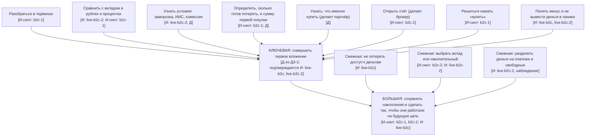

# ДЗ-4. Граф работ и карта сегментов

**Метки происхождения узлов:**
- **[И: файл]** услышано в расшифровке живого интервью (`live-b2c`, `live-b2c-2`);
- **[И-синт: файл]** взято из интервью с моделью (`synthetic-b2c-1`, `synthetic-b2c-2`, а для B2B также `live-b2b`, `synthetic-b2b-1`, `synthetic-b2b-2`), это слабее, чем живой респондент;
- **[Д]** достроено нами.

Живых интервью два: `live-b2c` (однокурсник, один из двух живых) и `live-b2c-2` (скептик; первая половина файла это наблюдения интервьюера, не интервью). B2B-интервью проведены только с моделью (`live-b2b`, `synthetic-b2b-1`, `synthetic-b2b-2`), живого собеседника из брокера найти не удалось. Поэтому Работа 3 остаётся гипотезой, в граф ниже вокруг B2C-работы она не входит, а её данные использованы в разделе про заработок.

## Граф работ по итогам интервью

| Уровень | Работа | Происхождение |
|---|---|---|
| Большая работа: ради чего | Сохранить накопления и сделать так, чтобы они работали на будущую цель (запас после учёбы, переезд), не потеряв их | [И: live-b2c] защитить деньги и от потери доступа, и от «лежат без дела»; [И-синт: b2c-1] «запас, когда закончу учёбу», «деньги обесцениваются»; [И-синт: b2c-2] накопить 400–500 тыс. на первые месяцы за границей |
| Ключевая работа: что продукт выполняет целиком | Совершить первое вложение | [Д] формулировка из ДЗ-2. Подтверждается: однокурсник вложил 1 000 ₽ и вышел при 800 ₽ [И: live-b2c]; Анна-1 дошла до экрана «купить» и закрыла его [И-синт: b2c-1]; скептик получил 4 длинные ОФЗ, купленные интервьюером по её выбору (сумма ~2 000 ₽), они ушли в минус [И: live-b2c-2, наблюдение] |
| Смежные работы: того же уровня, продуктом не выполняются | 1. Не потерять доступ к деньгам (разложить по банкам) | [И: live-b2c] |
| | 2. Выбрать, куда положить накопления: вклад или накопительный (Работа 1 из ДЗ-2) | [И-синт: b2c-2] вклад по рекламе в приложении банка, инвестиции не рассматривала; [И: live-b2c-2] накопительный выгоднее |
| | 3. Разделить деньги на обязательные платежи и свободные, следить за счетами | [И: live-b2c-2, наблюдение]. Учёт расходов мы вынесли за границы продукта в ДЗ-2 |
| Микроработы: из чего состоит ключевая | 1. Разобраться в терминах | [И-синт: b2c-1] посмотрела ~5 видео, бросила из-за непонятных слов |
| | 2. Сравнить ожидаемый результат с вкладом в рублях и процентах | [И: live-b2c-2] посчитал в чат-боте прибыль против накопительного, купон 30–60 ₽ оценивал в рублях, не в процентах; [И-синт: b2c-1] вклад 16% ≈ 24 тыс. ₽ в год |
| | 3. Узнать условия: заморозка, срок ИИС, комиссии | [И: live-b2c-2] ИИС = пять лет заморозки; [Д] комиссии и налог из критериев Работы 2 в ДЗ-2 |
| | 4. Определить, сколько готов потерять, и сумму первой покупки | [И-синт: b2c-1] хотела вложить 10 из 150 тыс. ₽; [Д] критерии из ДЗ-2 |
| | 5. Узнать, что именно купить | [Д]. Делает партнёр (брокер или советник). Из респондентов к советнику никто не обращался: Анна-2 сказала «особо ни к кому» [И-синт: b2c-2]; остальных про советника не спрашивали |
| | 6. Открыть брокерский счёт | [И-синт: b2c-1] ~40 минут с помощью подруги по видеосвязи. Делает брокер |
| | 7. Решиться нажать «купить» | [И-синт: b2c-1] ввела 10 000 ₽, увидела «≈33 акции» и закрыла экран |
| | 8. Понять минус и не вывести деньги в панике | [И: live-b2c] 1 000 → 800 ₽, вывел деньги; [И: live-b2c-2] «не понимаю, как вообще считается минус, выглядит как скам» |

## Критическая цепочка

Цепочка собрана по четырём B2C-респондентам. Это не один человек, а общий путь.

| Шаг | Что делает | Чем пользуется | Обрыв / переключение? |
|---|---|---|---|
| 1 | Получает толчок: у знакомой «что-то подросло», слышит про ИИС, или теряет доступ к деньгам | Чат с подругой, разговор с близким, событие [И: live-b2c; И-синт: b2c-1; И: live-b2c-2] | **Пауза:** Анна-1 «таскала мысль» две недели |
| 2 | Открывает счёт у брокера | Приложение брокера и подруга по видеосвязи, ~40 минут [И-синт: b2c-1] | Без помощи подруги непонятно, дошла бы (гипотеза [Д]) |
| 3 | Пытается разобраться | ~5 видео на YouTube, комментарии под бумагой [И-синт: b2c-1] | **Обрыв:** непонятные слова, в комментариях одни говорят «бери», другие «рано» |
| 4 | Сравнивает с вкладом или накопительным | Приложение банка (16% ≈ 24 тыс. ₽ в год) [И-синт: b2c-1]; чат-бот для расчёта прибыли [И: live-b2c-2] | **Переключение на вклад:** «там точно не потеряю»; скептик решил, что накопительный выгоднее |
| 5 | Доходит до экрана покупки | Приложение брокера [И-синт: b2c-1] | **Обрыв:** увидела «≈33 акции» на 10 000 ₽ и закрыла экран |
| 6 | Покупает и видит минус | Приложение брокера | **Обрыв:** однокурсник вывел деньги при 800 из 1 000 ₽ [И: live-b2c]; скептик не понимает, как считается минус, и называет это скамом [И: live-b2c-2] |
| 7 | Остаётся с бумагами или уходит | Приложение брокера | Скептик: «пусть лежит, всё равно ничего выводить нельзя»; купон 30–60 ₽ «мало, но хоть что-то» [И: live-b2c-2] |

Главные обрывы: на шагах 3 (непонятно), 5 (страшно сумма) и 6 (минус воспринимается как потеря).

## Карта сегментов

Сегменты выделены по работам и критериям успеха. Цифры приблизительные, источник указан в ячейках. Размеры сегментов оценить по данным нельзя, поэтому там допущения.

| Параметр | Сегмент 1: «Боюсь потерять» | Сегмент 2: «Считаю выгоду» | Сегмент 3: «Беру вклад по рекламе» |
|---|---|---|---|
| **Описание: работы и критерии успеха** | Работа 2. Хочет вложить небольшую сумму и знать максимум потерь; минус до продажи должен быть понятен. Критерий: сумма первой покупки определена заранее, понятно, когда минус становится убытком. Респонденты: однокурсник [И: live-b2c], Анна-1 [И-синт: b2c-1] | Работа 2 или 1. Считает доходность в процентах и сроке против накопительного, смотрит на заморозку и порог входа. Критерий: ИИС, облигации и накопительный сравнимы в процентах, без заморозки. Респондент: скептик [И: live-b2c-2] | Работа 1. Хочет быстро положить деньги под ставку выше накопительного в своём банке. Критерий: ставка заметно выше накопительного, открывается за вечер. Респондент: Анна-2 [И-синт: b2c-2] |
| **Размер: сколько таких людей** | Миллионы (порядок). На рынке 42+ млн инвесторов и 80+ млн счетов по данным Мосбиржи (поиск, 2026, актуальность проверить). Доля тех, кто открыл счёт и не торгует или ушёл после просадки, неизвестна. Допущение: 5–10% от 42 млн даёт 2–4 млн | Не оценивали, данных нет. Единичное наблюдение (один респондент) | Не оценивали. Допущение: вклады и накопительные самый массовый способ хранить накопления, поэтому сегмент большой, но у большинства нет работы «вложить» |
| **Частота работы** | Один раз «первое вложение», тревога повторяется при каждой просадке (однокурсник вывел сразу) | Один раз при выборе, потом «пусть лежит» | Каждые 6–12 месяцев при продлении вклада (Анна-2: август, потом ещё на полгода) |
| **Бюджет работы: сколько уже тратят** | 0 ₽ на знания: Анна-1 смотрела бесплатные видео, ~3 часа за пару вечеров. Однокурсник потерял 200 ₽ и вышел; про платные знания не спрашивали | 0 ₽: «ничего не покупал для знаний», использует бесплатный чат-бот | 0 ₽: «ни курсов, ни консультаций», платные советы в приложении банка не открывала |
| **Достижимость: можем ли дотянуться** | Через знакомых: триггер был социальный (подруга Лена в чате, разговор с близким). Каналы из ДЗ-2: студенческие сообщества, Telegram- и VK-каналы про личные финансы (гипотеза) | Трудно: сам обучение не ищет, не доверяет («скам»). Пришёл к теме через близкого человека | Только через банк: решение принимается в приложении банка по рекламе. Своего канала у нас нет |
| **Возможность создать ценность** | Высокая (гипотеза): боль в страхе и непонимании минуса. Можем показать максимум потерь в рублях и объяснить, что минус до продажи ещё не убыток. Подтверждено одним живым респондентом | Средняя или низкая: нужны честные цифры в процентах и условия заморозки, но он уже считает сам в чат-боте и сомневается | Низкая: проблему не чувствует, вклад её устраивает |
| **Конкуренция** | YouTube, знакомые, бесплатный AI Инвест-ассистент Т-Банка, ФинGPT; советник (платный, порог не проверяли) | Универсальные чат-боты (бесплатно), накопительный счёт | Приложение банка и реклама вклада, накопительный счёт |

## Обоснование выбора целевого сегмента

**Целевой сегмент: 1 «Боюсь потерять».**

**Как мы создаём для них ценность?** Работа 2 выполняется там, где люди застревают: перед покупкой («≈33 акции», сколько можно потерять) и в момент минуса. Мы переводим минус в понятные числа: максимум потерь в рублях, срок, издержки, что значит просадка и когда она становится убытком. Чем это лучше YouTube и друзей: даёт расчёт под конкретную сумму, а не общие слова. Что мы не делаем: не рекомендуем бумаги, это делает партнёр.

**Как мы на них зарабатываем?** Гипотеза из ДЗ-2: подписка 290–390 ₽ в месяц. Это самое слабое место. Из ответивших двое (живой скептик и Анна-2) прямо сказали, что не платили за знания, Анна-1 пользовалась бесплатным YouTube, однокурсника про это не спрашивали. Поэтому подписку не считаю подтверждённой.

Более вероятный источник дохода это B2B: сегмент 1 это те клиенты, которые открывают счёт и бросают его, и брокер платит за их активацию. B2B-интервью проведены только с моделью, все цифры придуманы ею. Со слов модели:
- показатель «доля первой сделки за 30 дней» есть у всех трёх персонажей [И-синт: live-b2b, synthetic-b2b-1, synthetic-b2b-2];
- специально под первую сделку никто ничего не покупал и подрядчикам за онбординг не платит: платят за платформы рассылок (~2,4–3 млн ₽ в год) и сервисы вроде NPS (~90 тыс. ₽ в месяц, пилот месяц бесплатно);
- всё дороже ~50 тыс. ₽ в месяц согласует финдиректор и просит показать эффект в рублях, а посчитать его в пунктах долей обычно не удаётся;
- комплаенс режет тексты, похожие на рекомендацию бумаги (это совпадает с нашей границей: ассистент объясняет, но не рекомендует), безопасность проверяет данные, цикл согласований 3–5 месяцев.

Вывод: платить за онбординг брокеру придётся «с нуля», нужен пилот с расчётом эффекта в деньгах. Это гипотеза до живого интервью.

**Как создаём спрос и растём?** Через знакомых: у Анны-1 толчком была подруга, у скептика я, у однокурсника событие. Каналы: студенческие сообщества и каналы про личные финансы (гипотеза). Хватит ли таких каналов, неизвестно. В B2B покупатель это руководитель CX или цифровых продуктов брокера (по интервью с моделью решает вместе с финдиректором); живого канала к нему у меня нет.

**От чего отказались и почему.**
- Сегмент 3 «Беру вклад по рекламе»: не чувствует проблемы, решение принимается в банковском приложении, где у нас нет канала. Проверен только на модели.
- Сегмент 2 «Считаю выгоду»: не платит и не ищет обучение, использует бесплатный чат-бот. Но его критерии важны для продукта (проценты вместо рублей, условия заморозки), поэтому они остаются в функциях.

## Что услышано и что изменилось в замысле

Что услышано в живых интервью: страх минуса и вывод денег (однокурсник), сравнение с накопительным и сомнение в выгоде (скептик), отсутствие платы за знания (скептик). Остальное в графе из модельных интервью или достроено нами. B2B-данные только от модели.

Что изменилось:
1. Ценность смещается от «подбора» к «понять минус, максимум потерь и считать в процентах до и после покупки».
2. Платная подписка B2C под вопросом: за знания пока никто не платил.
3. Расчёт сам по себе не отличает нас от конкурента: скептик получил его в универсальном чат-боте бесплатно.
4. Первый толчок чаще социальный: знакомые это канал.
5. В B2B (по интервью с моделью) брокеры ничего не покупали под первую сделку и просят эффект в рублях, поэтому пилот должен считать деньги, а не только пункты.

Что не проверено: работа 3 и вся B2B-часть (подтверждены только моделью), доля брошенных счетов у брокеров, готовность платить после первой покупки, роль советника.
